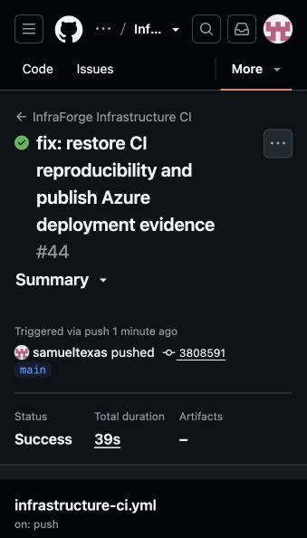

# InfraForge

**Azure Infrastructure as Code · Private networking · Identity-first security · Policy as code**

InfraForge is a working Azure infrastructure demonstration built and maintained
by **Samuel Texa**. It combines seven reusable Terraform modules with automated
security checks and an independently verifiable deployment record.

## Deployed on Azure

The Foundation and Integrated environments were deployed on **18 November 2026**.
The final apply created 10 missing resources without changing or destroying
existing resources. Terraform subsequently reported **no changes**. Azure
management APIs confirm the Storage Account is provisioned, private endpoints
are approved, containers are private, and scoped RBAC and diagnostics are present.

- **55 Terraform-managed resources:** 23 in Foundation and 32 in Integrated.
- **Private access:** Key Vault, Blob Storage and Azure Monitor private endpoints;
  shared DNS zones avoid duplicate ownership.
- **Identity-first Storage:** Entra ID default, Shared Key and local users disabled,
  container-scoped managed-identity permissions and infrastructure encryption.
- **Recovery controls:** blob versioning and 14-day soft deletion; LRS limitations
  are recorded in an architecture decision rather than hidden.
- **Cost control:** protected Free Trial credits, with the spending limit kept on.
  This is a credit-funded demonstration, not an always-free production platform.

**Review the evidence:** [Azure verification and CI history](docs/evidence/README.md)
· [Deployment runbook](docs/deployment.md)
· [Storage redundancy decision](docs/architecture/decisions/0001-demo-storage-redundancy.md)

The infrastructure is deployed and its management-plane configuration is working.
Application Blob read/write from the VNet, alert delivery and disaster recovery
are not yet demonstrated. The compute module is implemented but no VM is deployed
in this environment. These boundaries are explicit to keep the evidence credible.

View the successful GitHub Actions run

[31 jobs passed — run #44](https://github.com/samueltexas/InfraForge/actions/runs/44394995811).
Captured for commit `3808591`; the badge above tracks the current main branch.

## Reuse and operational maturity

The current release is [v2.0.0](https://github.com/samueltexas/InfraForge/releases/tag/v2.0.0). Pin consumers with a source such as
`git::https://github.com/samueltexas/InfraForge.git//modules/storage?ref=v2.0.0`.
Breaking changes since v1.0.0 are listed in [CHANGELOG](CHANGELOG.md).
Existing consumers must review the migration notes before upgrading. The original
v1.0.0 tag is unchanged. See the [versioning policy](docs/versioning.md).

- [Testing boundaries](docs/testing/README.md): structural Python tests plus 40
  native Terraform plan tests with mocked providers; not automated Azure E2E tests.
- [Operations](docs/operations/README.md): local read-only drift detection and cost
  review procedure. Scheduled drift and automated cost estimation are not active.
- [Remote state migration design](docs/operations/remote-state.md): lease locking,
  environment isolation and Entra OIDC. The deployed demonstration still uses
  local state; it is not yet a shared-team backend.
- [Why custom modules instead of AVM](docs/architecture/decisions/0002-custom-modules-and-avm.md):
  a deliberate design demonstration with a maintenance cost, not a vendor replacement.

## Engineering decisions to review

- **State ownership:** separate Foundation and Integrated states; deployed network
  and identity resources are referenced rather than recreated.
- **Safe recovery from a partial apply:** regional SKU discovery, state backups,
  reviewed fresh plans, no unplanned replacements and post-apply convergence.
- **Private provisioning:** management-plane operations allow deployment without
  temporarily exposing Storage or enabling account keys.
- **Quality gates:** Terraform validation and native tests, Python regression
  tests, TFLint, Checkov and OPA run in GitHub Actions. CI validates infrastructure;
  it does not automatically apply changes to Azure.
- **Documented tradeoffs:** the LRS security-policy exception applies only to the
  integrated demonstration. The reusable Storage module retains its GRS default.

## Architecture

InfraForge contains seven reusable Terraform modules composed through
integrated and developer-workload examples.

| Module | Responsibilities |
| --- | --- |
| Resource Group | Resource lifecycle boundary and governance tags |
| Networking | Virtual networks, subnets, NSGs and ingress controls |
| Identity | User-assigned managed identity and scoped RBAC |
| Key Vault | RBAC, secrets boundary, optional Storage CMK, private endpoints and DNS |
| Monitoring | Log Analytics, diagnostic settings, alerts and Azure Monitor Private Link |
| Compute | Hardened Linux VM, SSH authentication, Trusted Launch and managed identity |
| Storage | Private Blob Storage, regional redundancy, optional CMK, Entra ID, RBAC, diagnostics and Private Endpoint |

- [Architecture documentation](docs/architecture/README.md)
- [Architecture diagrams](docs/architecture/diagrams.md)
- [Integrated deployment guide](docs/deployment.md)
- [Foundation example](examples/foundation/main.tf)
- [Integrated example](examples/integrated/main.tf)
- [Developer workload example](examples/developer-workload/main.tf)

## Technology Stack

Terraform, Microsoft Azure, Docker, GitHub Actions,
Python, Checkov, TFLint and Open Policy Agent.

## Quick Start

From the repository root, run:

    ./scripts/validate.sh quick

This runs the Python infrastructure tests.

For Python tests, install the required Python dependencies,
including python-hcl2.

For complete Terraform configuration validation, start Docker
Desktop and run:

    ./scripts/validate.sh full

Full validation uses Terraform 1.14.0 in Docker.

Neither mode runs terraform apply or deploys Azure resources.

## Testing and Reliability

Validation results are generated by current local and GitHub Actions runs; historical test counts are intentionally not hard-coded.

The CI pipeline also performs Terraform validation, Checkov,
TFLint, OPA and module-specific security checks.

- [Testing documentation](docs/testing/README.md)
- [Engineering evidence](docs/evidence/README.md)

## Security

The project demonstrates least-privilege RBAC, managed identities,
private networking, Key Vault purge protection, restricted public
access, NSGs and automated security validation.

The integrated deployment has been verified through Azure management APIs.
Application-level private connectivity and alert delivery still require
runtime verification from the connected VNet; see the deployment guide.

## Repository Structure

    InfraForge/
      .github/workflows/
      docs/architecture/
      docs/evidence/
      docs/testing/
      examples/
      modules/
      policies/network/
      scripts/
      tests/
      Makefile
      README.md

## Developer Workload Example

The `examples/developer-workload` configuration demonstrates
how application teams compose the reusable infrastructure modules.

It exposes application-ready outputs including subnet IDs,
managed identity identifiers, Key Vault URI and monitoring resources.

See [Developer Workload Documentation](docs/developer-workload/README.md).

## Deployment Policy

**No Azure infrastructure is deployed by default.**

A real deployment requires authorization, valid cloud configuration,
security review, network verification and cost assessment.

## Project Status

| Component | Status |
| --- | --- |
| Resource Group | Terraform module implemented |
| Networking | Terraform module implemented |
| Identity | Terraform module implemented |
| Key Vault | Terraform module implemented; optional Storage CMK integration |
| Monitoring | Terraform module implemented |
| Compute | Terraform module implemented |
| Storage | Hardened module with CMK, RBAC and diagnostics |
| Integrated architecture | Foundation reused; private Storage, Key Vault and monitoring deployed |
| Live Azure deployment | Completed on 2026-11-18 under protected Free Trial credits |

## Author

**Samuel Texa**

## License

This project is licensed under the MIT License.
See the [LICENSE](LICENSE) file for details.

Copyright (c) 2026 Samuel Texa
