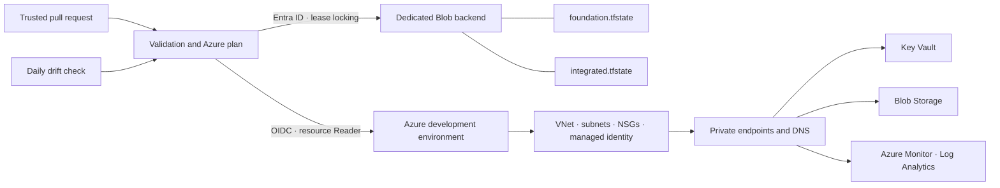

# InfraForge

[](https://github.com/samueltexas/InfraForge/actions/workflows/infrastructure-ci.yml)
[](https://github.com/samueltexas/InfraForge/actions/workflows/azure-plan.yml)

**Secure Azure infrastructure with Terraform, private application services and secretless operational checks — by Samuel Texa.**



## Deployment status and evidence

The demonstration was deployed manually on **2026-11-18**. Evidence is
**reproducible from the runbook** by an authorized operator; public snapshots
are operator-exported records, not independent cloud attestation.

| Area | Dated result | Evidence |
| --- | --- | --- |
| Azure deployment | 2026-11-18: 55 managed instances across Foundation (23) and Integrated (32) | [Azure snapshot and state address lists](docs/evidence/README.md) |
| State backend | 2026-11-19: migrated to separate Blob keys with Entra ID and lease locking | [Migration record](docs/evidence/2026-11-19/state-migration.json) · [ADR](docs/architecture/decisions/0004-remote-state-migration.md) |
| Validation | 2026-11-18: 31 CI jobs passed; 40 native Terraform plan runs use mocked providers | [Committed CI export](docs/evidence/2026-11-18/ci-verification.json) · [Test boundaries](docs/testing/README.md) |
| Live plans and drift | 2026-11-19: both OIDC Azure plans passed with no changes; daily schedule configured | [Committed results](docs/evidence/2026-11-19/github-verification.json) · [Operations](docs/operations/README.md) |

Counts describe the dated snapshot, not a permanent guarantee. CI proves code
validation; Azure API exports and Terraform output provide separate deployment
evidence. Sanitized records are committed to Git because Actions logs/artifacts
can expire. The CI screenshot is supplementary evidence only.

## Quick start — no Azure account required

```bash
# Install the Python dependencies pinned in CI, then run structural checks:
./scripts/validate.sh quick

# Native Terraform tests use mocked providers and do not create Azure resources:
terraform -chdir=modules/storage init -backend=false -input=false -lockfile=readonly
terraform -chdir=modules/storage test
```

To deploy your own environment, follow the [deployment runbook](docs/deployment.md)
and [backend setup](docs/operations/remote-state.md). **The repository never applies
infrastructure automatically.** The recorded deployment was operator-run; cloning
or running offline validation does not require deploying a copy in Azure.

## What to review

- **Architecture:** seven reusable modules, separate stack ownership, private
  application endpoints and per-container managed-identity RBAC.
- **Operational safety:** preserved state during migration, lease locking,
  secretless resource-read identities, reviewed plans and redacted PR summaries.
- **Engineering tradeoffs:** [custom modules versus AVM](docs/architecture/decisions/0002-custom-modules-and-avm.md),
  [LRS demonstration limits](docs/architecture/decisions/0001-demo-storage-redundancy.md)
  and [state/backend boundaries](docs/architecture/decisions/0004-remote-state-migration.md).
- **Versioning:** immutable tags, [CHANGELOG](CHANGELOG.md), breaking-change guidance
  and [Git module source examples](docs/versioning.md). v1.0.0 and v2.0.0 remain available.

## Scope and limitations

This is a credit-funded Azure Free Trial demonstration with its spending limit
retained, not an always-free or production-certified platform. Application services
are private; the dedicated state backend uses an authenticated HTTPS public
endpoint for GitHub-hosted runners. No anonymous Blob access or Shared Key is enabled.

Workload Blob read/write, alert delivery and disaster-recovery drills remain
unverified. No VM or production environment is deployed. Automated cost estimation
and cloud apply automation are not enabled; the apply environment is reserved
with manual approval. See [operations](docs/operations/README.md).

**Tooling:** Terraform and `terraform test`, Azure CLI, GitHub Actions/OIDC, Python,
Docker, Checkov, TFLint and OPA. [Architecture](docs/architecture/README.md) ·
[Testing](docs/testing/README.md) · [Evidence](docs/evidence/README.md)

Author: **Samuel Texa** · [MIT License](LICENSE)
