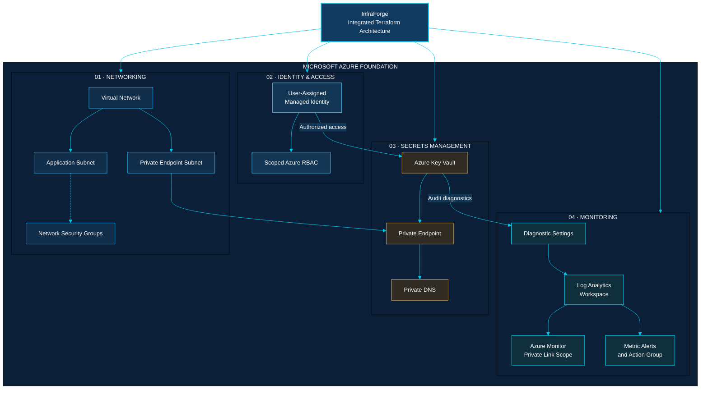
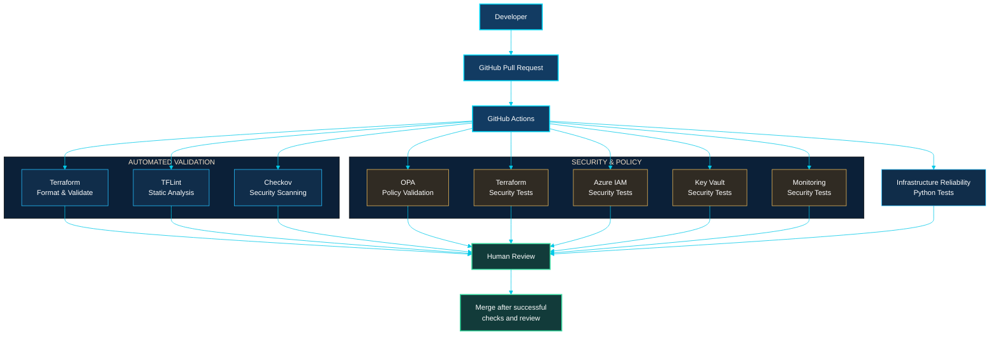
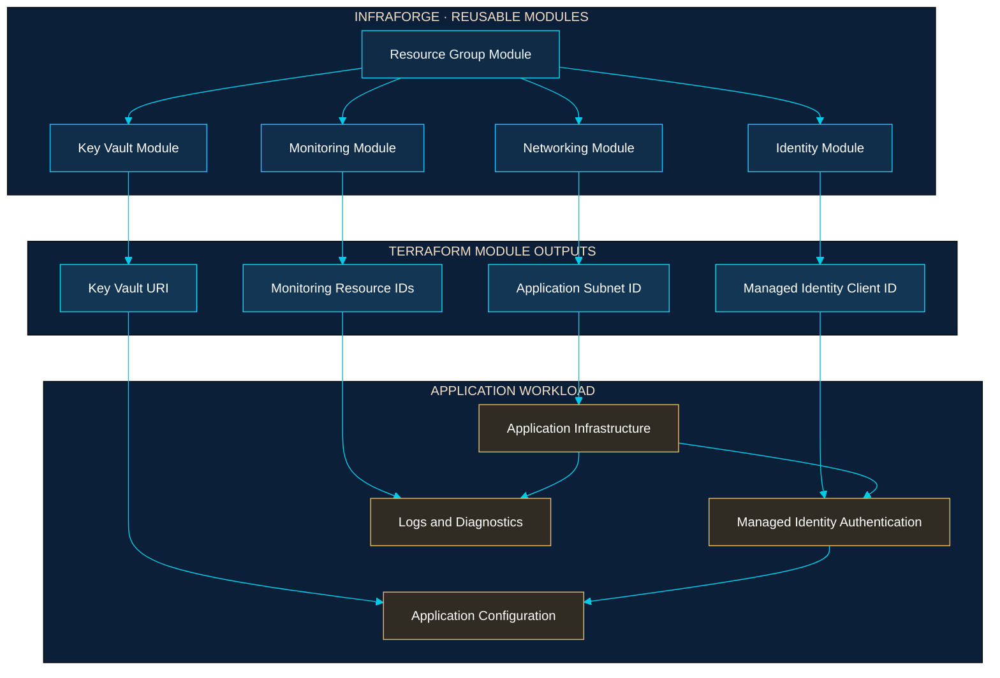

# Architecture Diagrams

> Visual identity: Dark Cloud Engineering
> Palette: Midnight Navy, Electric Cyan, Azure Blue and Ice White.

These diagrams represent the Terraform configurations and engineering
workflows implemented in this repository. They do not represent a live
Azure deployment.

## 1. Azure Infrastructure Architecture

The integrated architecture connects five reusable Terraform modules, including a shared Resource Group foundation.
Networking provides connectivity, Identity provides managed access,
Key Vault protects application secrets, and Monitoring provides
diagnostics and observability.

## 2. DevSecOps CI/CD Pipeline

The pipeline validates infrastructure changes before they are
considered ready for review and merge.

The diagram represents the validation workflow. It does not imply
that GitHub branch protection or mandatory status checks have
been configured.

## 3. Developer Workload Integration

This example demonstrates how an application team can consume the
outputs exposed by InfraForge's reusable Terraform modules.

### Integration contract

| Module | Application-facing output |
|---|---|
| Networking | Application subnet ID |
| Identity | Managed identity client ID |
| Key Vault | Key Vault URI |
| Monitoring | Workspace and monitoring resource IDs |

The example demonstrates Terraform composition and output
consumption. It does not deploy an application or prove
runtime connectivity to Azure.

---

## Architecture validation boundaries

- Terraform formatting and configuration validation are local checks.
- Python tests validate infrastructure contracts and security assumptions.
- CI/CD checks validate repository configurations and policies.
- Azure deployment and runtime connectivity require separate verification.
- No Azure resources are provisioned by these diagrams.

## Technology foundation

Terraform · Microsoft Azure · GitHub Actions · Docker · Python ·
Checkov · TFLint · Open Policy Agent

**Author:** Samuel Texa
