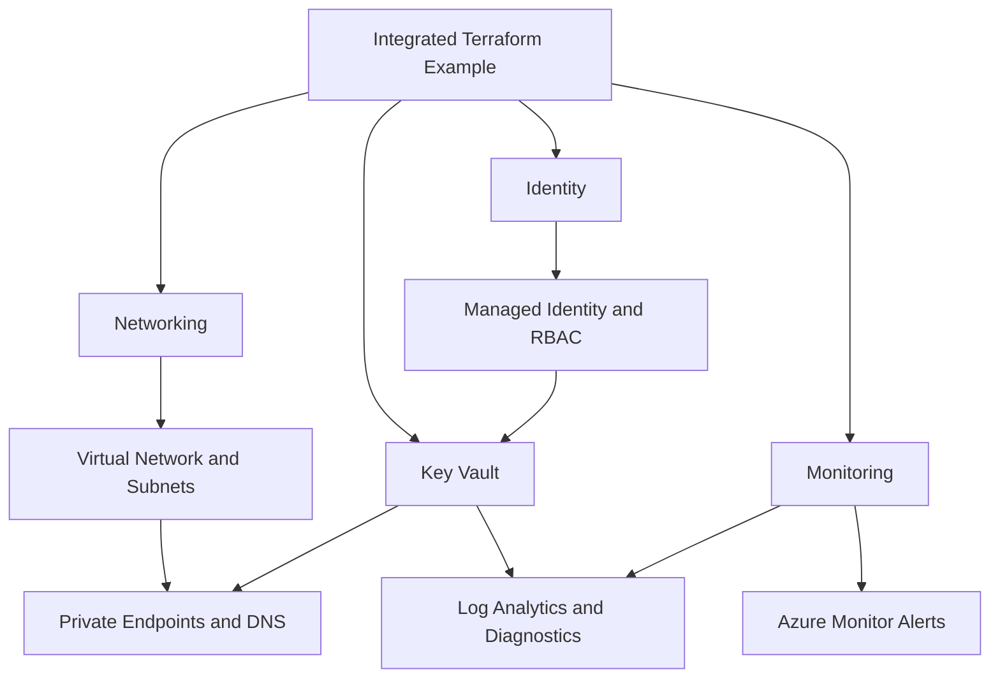
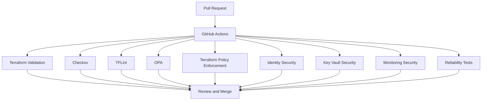

# InfraForge Architecture Diagrams

These diagrams describe the intended Terraform infrastructure,
not a live Azure deployment.

## Integrated Infrastructure

## DevSecOps CI/CD

The review diagram does not imply that GitHub branch protection
or mandatory status checks have been configured.
