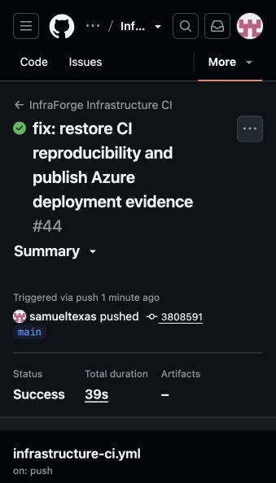

# Deployment and engineering evidence

Author: Samuel Texa

## Live Azure deployment — 18 November 2026

InfraForge is deployed in Azure. The Foundation state owns 23 resources and the
Integrated state owns 32. The completion apply created 10 Storage resources,
changed zero resources and destroyed zero resources. A subsequent refreshed
Terraform plan reported no changes; the same check was repeated during CI triage.

- [Redacted Azure verification snapshot](2026-11-18/azure-verification.json)
- [Foundation state addresses](2026-11-18/foundation-state-list.txt)
- [Integrated state addresses](2026-11-18/integrated-state-list.txt)
- [Terraform convergence excerpt](2026-11-18/terraform-convergence.txt)
- [Deployment configuration commit](https://github.com/samueltexas/InfraForge/commit/ffdb9d4eadc701958db7d77e6fe1a125366b1751)
- [Deployment procedure and cost constraints](../deployment.md)
- [Scoped redundancy decision](../architecture/decisions/0001-demo-storage-redundancy.md)

The JSON snapshot is generated from real Azure API responses, with subscription,
tenant, principal identifiers and private account details omitted. Resource/account
names are replaced by logical labels. It records checks and timestamps. It is an operator-captured snapshot,
not independent certification or a continuous uptime guarantee.

## Verified CI result

[Run #44](https://github.com/samueltexas/InfraForge/actions/runs/44394995811)
completed successfully for commit `3808591`: **31 jobs passed**. This includes
Checkov, Python/OPA, formatting, 14 Terraform targets and 14 TFLint targets.
The local Checkov 3.4.5 scan reported 122 passed, zero failed and eight skipped
checks. Exceptions remain visible in source and the redundancy ADR.

- [GitHub API result](2026-11-18/ci-verification.json)
- Screenshot below: an unedited browser capture of the successful run summary.
  It is CI evidence, not an Azure portal screenshot.



GitHub also reports non-failing Node.js 20 action-runtime deprecation warnings.
The runner executes those pinned actions on Node.js 24; updating action versions
is a future maintenance task. A successful run does not imply zero warnings.

## Reproduce the verification

With Azure CLI authenticated to the intended subscription:

```bash
python3 scripts/verify_azure_deployment.py --output /tmp/azure-verification.json
export ARM_SUBSCRIPTION_ID="<your-subscription-id>"
terraform -chdir=examples/integrated plan -input=false -detailed-exitcode
```

The script only reads Azure resources. Exit code 0 means all recorded checks
passed; it does not modify infrastructure. The Terraform command requires authorized access to the remote backend. State
values are intentionally excluded from Git. Exit code 0
means no pending changes; 2 means differences; 1 means an error.

## CI incident and resolution

The screenshot of CI run #40 refers to commit `5ecf043` on 13 November, before
the live deployment. Its failures included Storage policy findings and a
provider checksum mismatch. Later runs passed before the deployment change.

Run [44339915677](https://github.com/samueltexas/InfraForge/actions/runs/44339915677)
then identified two issues in the deployment commit:

1. The Foundation provider lock file lacked the Linux package checksum used by
   GitHub's runner. Regenerating signed checksums for Linux AMD64 and macOS ARM64
   fixes reproducibility without disabling checksum verification.
2. CKV_AZURE_206 rejected the demonstration's LRS redundancy. LRS is deliberately
   retained with an exception on that module call only. The decision records
   the absence of zone/regional disaster recovery and production review triggers.
   This is an accepted demonstration limitation, not a false-positive claim.

Neither CI run executes Terraform apply. A failed validation workflow does not
roll back or delete the deployed Azure resources. The failed runs remain in the
history; corrected runs provide the evidence of resolution.

## What is verified

Azure provisioning, authentication configuration, encryption configuration,
private endpoint approval, private DNS record presence, three private containers,
container-scoped RBAC and Blob/Queue diagnostics. The spending limit remains on.

## What is not yet verified

- Application reads/writes and DNS resolution from a workload inside the VNet.
- Actual log ingestion and end-to-end alert delivery. The action group currently
  has no email receivers.
- Restore drills, regional disaster recovery, availability SLA or load tests.
- Production environment isolation and recovery drills. Development states were
  migrated to Azure Blob on 2026-11-19; production has not been deployed.

No VM or paid connectivity service was created only to produce evidence.

## Remote-state milestone — 2026-11-19

[Migration comparison](2026-11-19/state-migration.json) records preservation of
lineage, all resources and all outputs. It contains no state values or raw IDs.
The state address exports in the 2026-11-18 directory were exported on 2026-11-19
from the protected pre-migration snapshot; their headers make that timing explicit.

Public snapshots are operator-exported evidence reproducible from the runbook,
not independent attestation of a subscription a third party cannot access.
Actions run links may expire under GitHub retention settings. Committed sanitized
records remain available in Git; screenshots are supplementary, not deployment proof.
The CI screenshot contains only the public GitHub handle already in the repository
URL, not an Azure login, email, tenant or subscription identifier. Earlier Git history
may retain resource labels; no state values or credentials were intentionally published.

Post-migration normal plans: [Foundation](2026-11-19/foundation-operator-plan.json) and [Integrated](2026-11-19/integrated-operator-plan.json), both exit 0 with no resource actions. Refreshed state differences count provider-observed state changes; it is not a count of planned infrastructure changes. These plans did not persist refresh updates through an apply.
